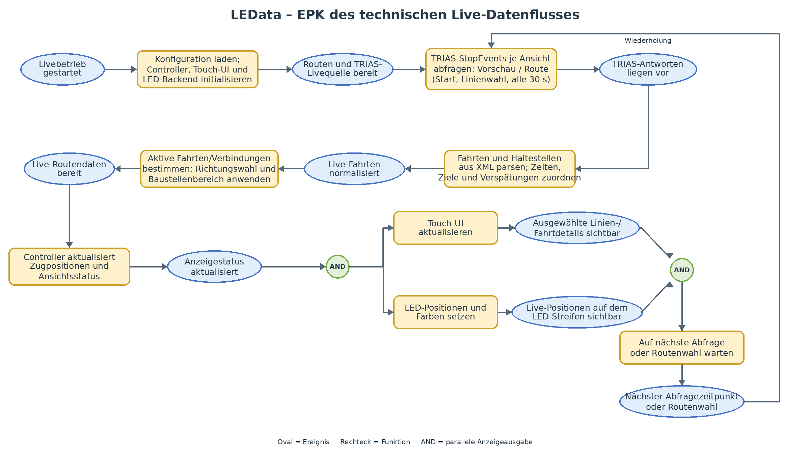

# Projektdokumentation

## LEData

**Tabelle 1: Beteiligung am Gesamtprojekt**

| Beteiligte Person | Beteiligung am Gesamtprojekt |
|---|---:|
| Lena Hackenjos | 25 % |
| Valentino Schreiner | 25 % |
| Raffael Langklotz | 25 % |
| Jannik Brack | 25 % |
| **Gesamt** | **100 %** |

## Inhaltsverzeichnis

1. [Projektauftrag](#1-projektauftrag) — Seite: nach Export
2. [Teamsitzungsprotokolle](#2-teamsitzungsprotokolle) — Seite: nach Export
3. [Organisatorischer Teil](#3-organisatorischer-teil) — Seite: nach Export
   1. [Aufbauorganisation](#31-aufbauorganisation) — Seite: nach Export
   2. [Technische EPK im Live-Betrieb](#32-technische-epk-im-live-betrieb) — Seite: nach Export
4. [Inhaltlicher Teil](#4-inhaltlicher-teil) — Seite: nach Export
   1. [Systemübersicht](#41-systemübersicht) — Seite: nach Export
   2. [Live-Datenquelle](#42-live-datenquelle) — Seite: nach Export
   3. [Datenverarbeitung](#43-datenverarbeitung) — Seite: nach Export
   4. [Touchdisplay und Bedienung](#44-touchdisplay-und-bedienung) — Seite: nach Export
   5. [Hardware und LED-Anzeige](#45-hardware-und-led-anzeige) — Seite: nach Export
5. [Abschlussbericht](#5-abschlussbericht) — Seite: nach Export
   1. [Kontrolle](#51-kontrolle) — Seite: nach Export
   2. [Ergebnisse](#52-ergebnisse) — Seite: nach Export
   3. [Reflexion der Gruppenarbeit](#53-reflexion-der-gruppenarbeit) — Seite: nach Export
6. [Quellenverzeichnis und KI-Prompts](#6-quellenverzeichnis-und-ki-prompts) — Seite: nach Export
7. [Abbildungsverzeichnis](#7-abbildungsverzeichnis) — Seite: nach Export
8. [Materialverzeichnis](#8-materialverzeichnis) — Seite: nach Export
9. [Anhang A: Formatcheck für den Export](#anhang-a-formatcheck-für-den-export) — Seite: nach Export

## 1 Projektauftrag

## 2 Teamsitzungsprotokolle

### Vorlage Ergebnisprotokoll

**Protokollnummer:** [eintragen] 
**Datum und Uhrzeit:** [eintragen] 
**Teilnehmende:** [eintragen] 
**Protokollführung:** [eintragen]

#### Tagesordnung

1. [Tagesordnungspunkt]
2. [Tagesordnungspunkt]

#### Ergebnisse und Beschlüsse

**Tabelle 2: Ergebnisse und Beschlüsse des Teams**

| Tagesordnungspunkt | Ergebnis/Beschluss |
|---|---|
| [Punkt] | [Ergebnis oder Beschluss] |

#### Aufgaben

**Tabelle 3: Aufgaben aus der Teamsitzung**

| Aufgabe | Zuständig | Termin | Status |
|---|---|---|---|
| [Aufgabe] | [Name] | [Datum] | [offen/erledigt] |

## 3 Organisatorischer Teil

### 3.1 Aufbauorganisation

Die Zuständigkeiten innerhalb des Teams werden den folgenden Arbeitsbereichen noch zugeordnet.

**Tabelle 4: Aufbauorganisation und Zuständigkeiten**

| Arbeitsbereich | Zuständige Person(en) |
|---|---|
| API | [wird ergänzt] |
| Verarbeitungslogik | [wird ergänzt] |
| Hardware | [wird ergänzt] |
| Software | [wird ergänzt] |

### 3.2 Technische EPK im Live-Betrieb

Die EPK zeigt den technischen Datenfluss des Live-Betriebs. Der optionale Fahrplanmodus ist nicht dargestellt.

**Abbildung 1: Technischer Live-Datenfluss von LEData**

## 4 Inhaltlicher Teil

Die technische Darstellung basiert auf dem aktuellen Repository-Stand, insbesondere auf `main.py`, `live_feed.py`, `classes.py`, `ui.py` und `meta.json`. Ein genauer Versions- und Datumsnachweis wird im Quellenverzeichnis ergänzt.

### 4.1 Systemübersicht

LEData visualisiert Live-Daten einer Straßenbahn in Freiburg auf einem LED-Streifen und einem Touchdisplay. Die Anwendung besteht aus einer Python-Software, einer Datenanbindung an den Live-Dienst und einer Anzeigesteuerung für Touchdisplay und LEDs.

### 4.2 Live-Datenquelle

Im Live-Modus fragt LEData den in der Konfiguration hinterlegten TRIAS-Dienst ab. Die Anfragen verwenden die den Haltestellen und Linien zugeordneten Referenzen. Angefordert werden Echtzeitdaten zu Abfahrten und zugehörigen Haltestelleninformationen.

### 4.3 Datenverarbeitung

Die Anwendung liest Linien-, Haltestellen- und LED-Zuordnungen aus `meta.json`. Die TRIAS-Antworten werden aus XML in Fahrten und Haltestellenaufrufe umgewandelt; dabei werden unter anderem geplante und prognostizierte Zeiten sowie Verspätungen übernommen. Anschließend werden die aktiven Fahrten der jeweiligen Route zugeordnet und an den Controller übergeben. Live-Daten werden standardmäßig alle 30 Sekunden aktualisiert. Richtungs- und Baustellenauswahl beeinflussen, welche Fahrten und Streckenabschnitte angezeigt werden.

Bei vollständig fehlgeschlagenen TRIAS-Abfragen wird der Fehler protokolliert. Die zuletzt verfügbaren Zugdaten bleiben erhalten, bis neue Daten erfolgreich verarbeitet werden.

### 4.4 Touchdisplay und Bedienung

Die Touchscreen-Oberfläche ist mit Tkinter umgesetzt und ermöglicht die Auswahl einer Linie sowie – abhängig von der Ansicht – einer Fahrt oder Fahrtrichtung. Sie zeigt Informationen zu Fahrt, Haltestellen, Ziel und Verspätung. Im Live-Modus kann die Linienauswahl eine dynamische Vorschau der aktiven Bahnen anzeigen.

### 4.5 Hardware und LED-Anzeige

Die LED-Anzeige bildet die Streckenabschnitte und Haltestellen räumlich ab. Aktive Bahnen werden in der Linienfarbe dargestellt; Haltestellenpositionen können weiß markiert werden. Ein gesperrter Streckenabschnitt wird gelb markiert. Für die Projektkonfiguration sind 300 LEDs an GPIO 18 mit 800 kHz Signalrate und einem Helligkeitswert von 100 hinterlegt. Die LED-Ansteuerung nutzt `rpi_ws281x`; für Tests ohne Raspberry-Pi-Hardware gibt es ein Software-Backend.

Im Repository sind außerdem 3D-Modelle für eine modulare Schiene mit WS2812B-LED-Streifen dokumentiert. Die konkreten verwendeten Bauteile und Materialmengen werden im Materialverzeichnis ergänzt.

## 5 Abschlussbericht

### 5.1 Kontrolle

**Tabelle 5: Soll-Ist-Kontrolle**

| Prüfkriterium/Ziel | Soll | Ist | Abweichung/Bewertung |
|---|---|---|---|
| [Kriterium] | [Sollwert] | [Ergebnis] | [Bewertung] |
| [Kriterium] | [Sollwert] | [Ergebnis] | [Bewertung] |

### 5.2 Ergebnisse

- **Umgesetzte Ergebnisse:** [ergänzen]
- **Nicht oder teilweise umgesetzte Ziele:** [ergänzen]
- **Ergebnis der Präsentation/Erprobung:** [ergänzen]

### 5.3 Reflexion der Gruppenarbeit

- **Was lief in der Zusammenarbeit gut?** [ergänzen]
- **Welche Schwierigkeiten gab es?** [ergänzen]
- **Wie wurden Aufgaben und Entscheidungen abgestimmt?** [ergänzen]
- **Was würden wir beim nächsten Projekt anders machen?** [ergänzen]

## 6 Quellenverzeichnis und KI-Prompts

Im Text werden Quellen einheitlich mit Kurzbelegen nach dem Muster **(Autor/Organisation, Jahr)** angegeben. Jede zitierte Quelle wird vollständig im Verzeichnis aufgeführt. Für Internetquellen werden zusätzlich die URL und das Abrufdatum angegeben.

### Literatur

**Muster:** 
Nachname, Vorname (Jahr): *Titel*. Verlag, Erscheinungsort.

- [Quelle nach dem Muster ergänzen]

### Internetquellen

**Muster:** 
Autor/Organisation (Jahr oder o. J.): *Titel der Seite/des Dokuments*. URL: [vollständige URL], abgerufen am [TT.MM.JJJJ].

- [Quelle nach dem Muster ergänzen]

### Interne Projektunterlagen

**Muster:** 
Projektteam LEData (Jahr): *Quellcode/Projektunterlage*, Dateiname oder Version, unveröffentlichte Projektunterlage.

- [verwendete interne Unterlage ergänzen]

### KI-Nutzung und verwendete Prompts

Für jede verwendete KI-Unterstützung werden Werkzeug/Modell, Datum und der vollständige Prompt dokumentiert. Zusätzlich wird festgehalten, welche Ausgabe übernommen oder wie sie überarbeitet wurde.

**Tabelle 6: Dokumentation der KI-Nutzung und verwendeter Prompts**

| KI-Werkzeug/Modell | Datum | Zweck | Vollständiger Prompt | Verwendete/überarbeitete Ausgabe |
|---|---|---|---|---|
| [eintragen] | [TT.MM.JJJJ] | [eintragen] | [vollständigen Prompt einfügen] | [eintragen] |

## 7 Abbildungsverzeichnis

**Tabelle 7: Abbildungsverzeichnis**

| Abbildung | Titel | Seite |
|---|---|---:|
| 1 | Technischer Live-Datenfluss von LEData | nach Export |

## 8 Materialverzeichnis

**Tabelle 8: Materialverzeichnis**

| Material/Komponente | Menge | Verwendung | Bezugsquelle |
|---|---:|---|---|
| [eintragen] | [eintragen] | [eintragen] | [Händler/URL/Bezugsweg] |

## Anhang A: Formatcheck für den Export

- DIN A4
- Seitenränder links und rechts jeweils 30 mm
- Schriftgröße 12 pt in einer gut lesbaren serifenlosen Proportionalschrift
- 1,5-facher Zeilenabstand
- Abbildungen und Tabellen fortlaufend nummerieren und beschriften
- Höchstens zehn Seiten reiner Inhalt; Deckblatt, Inhaltsverzeichnis, Abbildungs- und Quellenverzeichnis sowie Anhang zählen laut Vorgabe nicht dazu
- Inhaltsverzeichnis-Seitenzahlen nach dem Seitenlayout in Word/PDF aktualisieren
