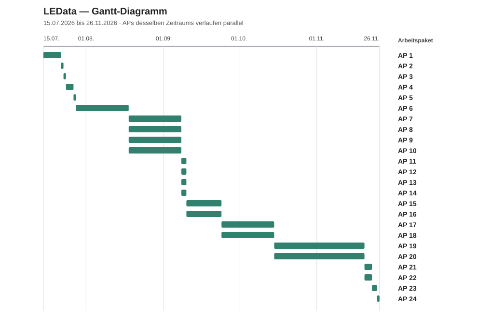
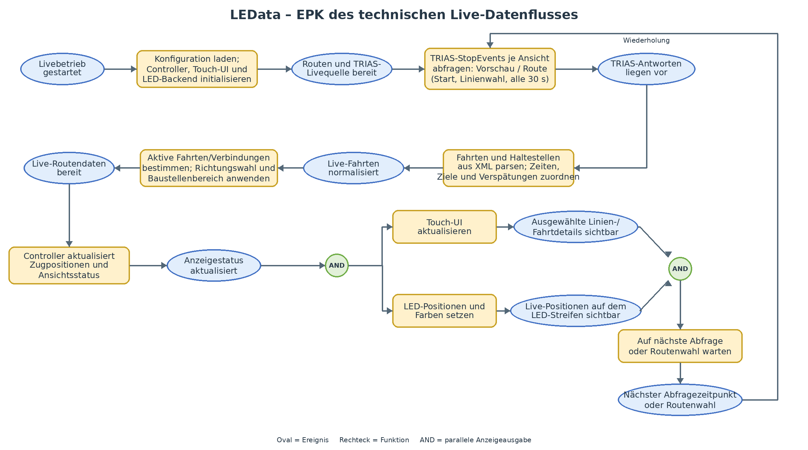

# Projektdokumentation

## LEData

**Tabelle 1: Beteiligung am Gesamtprojekt**

| Beteiligte Person   | Beteiligung am Gesamtprojekt |
|---------------------|-----------------------------:|
| Lena Hackenjos      |                         25 % |
| Valentino Schreiner |                         25 % |
| Raffael Langklotz   |                         25 % |
| Jannik Brack        |                         25 % |
| **Gesamt**          |                    **100 %** |

## Inhaltsverzeichnis

<mark> kommt noch </mark>

## 1 Projektauftrag
<mark> kommt noch </mark>

## 2 Teamsitzungsprotokolle

<mark> kommt noch </mark>

## 3 Organisatorischer Teil

### 3.1 Aufbauorganisation

Die folgende Übersicht fasst die in den Sitzungsprotokollen dokumentierte Aufgabenverteilung zusammen. Sie beschreibt keine dauerhaften Ressortzuständigkeiten; Integrations- und Hardwareaufgaben wurden teilweise gemeinsam erledigt.

**Tabelle 4: Aufgabenverteilung laut Sitzungsprotokollen**

| Aufgabe/Arbeitsbereich                         | Zuständig laut Protokoll                                                            |
|------------------------------------------------|-------------------------------------------------------------------------------------|
| TRIAS-Abfrage und Live-Datenanbindung          | Raffael Langklotz, Valentino Schreiner                                              |
| Fahrtenmodell und Startlogik                   | Jannik Brack; Startlogik gemeinsam mit Lena Hackenjos                               |
| Baustellenlogik und Grenzsortierung            | Lena Hackenjos; Korrektur gemeinsam mit Jannik Brack                                |
| Touchdisplay: Fahrtübersicht                   | Valentino Schreiner                                                                 |
| Touchdisplay: Detailansicht                    | Raffael Langklotz                                                                   |
| Tests und Regression                           | Valentino Schreiner, Raffael Langklotz                                              |
| LED-Ansteuerung, Linienvermessung und Hardware | Jannik Brack; Fehlersuche, Vermessung und Fertigstellung teilweise im gesamten Team |

### 3.2 Projektstrukturplan

Für die Zuordnung gilt: AP 1 bis AP 6 umfassen jeweils alle Arbeitsschritte des gleich nummerierten Protokolls. Ab Protokoll 7 wird innerhalb jedes Protokolls für jede unterschiedliche Zuständigkeit ein neues AP angelegt; mehrere Einträge derselben Zuständigkeit innerhalb eines Protokolls gehören zum selben AP.

#### Projektstrukturplan (Entwurf)

Die Arbeitspakete wurden aus den Sitzungsprotokollen übernommen und entsprechend der festgelegten AP-Zuordnung zusammengefasst. Der dokumentierte Ergebnisstand wird wiedergegeben; ein formales Abnahmekriterium ist in den Protokollen nicht für jedes AP festgehalten.

**Tabelle 5: Projektstrukturplan (Entwurf aus den Sitzungsprotokollen)**

| AP-Code | Arbeitspaket                                 | Aufgaben/Abgrenzung                                                                                                              | Ergebnis/Stand laut Protokoll                                                                            | Zuständig                                                                                                 |
|---------|----------------------------------------------|----------------------------------------------------------------------------------------------------------------------------------|----------------------------------------------------------------------------------------------------------|-----------------------------------------------------------------------------------------------------------|
| AP 1    | Ausstattung und Display vorbereiten          | Komponenten auspacken; Touchdisplay montieren und ansteuern                                                                      | Display wurde angesteuert (im Protokoll mit Häkchen markiert); übrige Schritte als Ergebnisse aufgeführt | Zuständigkeit nicht angegeben                                                                             |
| AP 2    | Stromversorgung und TRIAS-Zugang vorbereiten | Stromversorgung testen; TRIAS-Zugang anfragen                                                                                    | Beide Schritte als Ergebnisse des Tages aufgeführt                                                       | Stromversorgung: Jannik Brack und Lena Hackenjos; TRIAS-Zugang: Raffael Langklotz und Valentino Schreiner |
| AP 3    | LED-Ansteuerung und TRIAS-Abfrage prüfen     | LED-Ansteuerung untersuchen; TRIAS-Abfrage durchführen                                                                           | LED-Ansteuerung fehlerhaft; TRIAS-Abfrage erfolgreich                                                    | LED-Ansteuerung: Jannik Brack; TRIAS-Abfrage: Raffael Langklotz und Valentino Schreiner                   |
| AP 4    | LED-Fehlersuche                              | LED-Fehler untersuchen und Fehlersuche durchführen                                                                               | Fehler ungelöst; Fehlersuche erfolglos                                                                   | Fehleruntersuchung: gesamtes Team; Fehlersuche: Jannik Brack                                              |
| AP 5    | LED-Protokoll und Muster erproben            | WS2812B-Protokoll erkennen; LED-Muster testen                                                                                    | WS2812B-Protokoll erkannt; LED-Muster getestet                                                           | Protokoll: gesamtes Team; LED-Muster: Jannik Brack                                                        |
| AP 6    | Linien vermessen und Schnittstellen klären   | Linien vermessen; offene Schnittstellen erfassen                                                                                 | Linien vermessen; Schnittstellen noch offen                                                              | Linienvermessung: gesamtes Team; Schnittstellen: Zuständigkeit nicht angegeben                            |
| AP 7    | Fahrtenmodell abstimmen                      | Fahrtenmodell abstimmen                                                                                                          | Abstimmung als Arbeitsschritt dokumentiert                                                               | Jannik Brack                                                                                              |
| AP 8    | Baustellenlogik planen                       | Baustellenlogik planen                                                                                                           | Planung als Arbeitsschritt dokumentiert                                                                  | Lena Hackenjos                                                                                            |
| AP 9    | Fahrtübersicht konzipieren                   | Fahrtübersicht konzipieren                                                                                                       | Konzeption als Arbeitsschritt dokumentiert                                                               | Valentino Schreiner                                                                                       |
| AP 10   | Detailansicht konzipieren                    | Detailansicht konzipieren                                                                                                        | Konzeption als Arbeitsschritt dokumentiert                                                               | Raffael Langklotz                                                                                         |
| AP 11   | Fahrtenmodell umsetzen                       | Abgestimmtes Fahrtenmodell umsetzen                                                                                              | Als umgesetzt dokumentiert                                                                               | Jannik Brack                                                                                              |
| AP 12   | Baustellenlogik umsetzen                     | Geplante Baustellenlogik umsetzen                                                                                                | Als umgesetzt dokumentiert                                                                               | Lena Hackenjos                                                                                            |
| AP 13   | Fahrtübersicht umsetzen                      | Konzipierte Fahrtübersicht umsetzen                                                                                              | Als umgesetzt dokumentiert                                                                               | Valentino Schreiner                                                                                       |
| AP 14   | Detailansicht umsetzen                       | Konzipierte Detailansicht umsetzen                                                                                               | Als umgesetzt dokumentiert                                                                               | Raffael Langklotz                                                                                         |
| AP 15   | Betriebsmodi integrieren                     | Betriebsmodi integrieren                                                                                                         | Als Arbeitsschritt dokumentiert; Status nicht näher angegeben                                            | Jannik Brack und Lena Hackenjos                                                                           |
| AP 16   | Regressionstests planen                      | Regressionstests planen                                                                                                          | Planung dokumentiert                                                                                     | Valentino Schreiner und Raffael Langklotz                                                                 |
| AP 17   | Startlogik umsetzen                          | Startlogik umsetzen                                                                                                              | Als umgesetzt dokumentiert                                                                               | Jannik Brack und Lena Hackenjos                                                                           |
| AP 18   | Testsuite erweitern                          | Testsuite erweitern                                                                                                              | Als Ergebnis des Tages aufgeführt                                                                        | Valentino Schreiner und Raffael Langklotz                                                                 |
| AP 19   | Grenzsortierung korrigieren                  | Grenzsortierung korrigieren                                                                                                      | Als korrigiert dokumentiert                                                                              | Lena Hackenjos und Jannik Brack                                                                           |
| AP 20   | Richtungstests ergänzen                      | Richtungstests ergänzen                                                                                                          | Als Ergebnis des Tages aufgeführt                                                                        | Valentino Schreiner und Raffael Langklotz                                                                 |
| AP 21   | Veraltete Antworten verwerfen                | Veraltete Antworten verwerfen                                                                                                    | Als Ergebnis des Tages aufgeführt                                                                        | Jannik Brack und Lena Hackenjos                                                                           |
| AP 22   | Regressionstests abschließen                 | Regressionstests abschließen                                                                                                     | Als abgeschlossen dokumentiert                                                                           | Valentino Schreiner und Raffael Langklotz                                                                 |
| AP 23   | Hardware fertigstellen                       | Druckteile verkleben; LED-Streifen in das Darstellungsmodell einsetzen; Lötstellen herstellen; Raspberry Pi mit Gehäuse versehen | Hardware als fertiggestellt dokumentiert; Einzelschritte im protokollierten Arbeitsablauf genannt        | Hardwarefertigstellung: gesamtes Team; Zuständigkeit für Einzelschritte nicht separat angegeben           |
| AP 24   | Projektdokumentation erstellen und abgeben   | Projektdokumentation schreiben und abgeben                                                                                       | Als abgeschlossen dokumentiert                                                                           | Jannik Brack, Lena Hackenjos, Raffael Langklotz und Valentino Schreiner                                   |

### 3.3 Zeitplanung

Die Zeiträume sind aus den Datumsangaben der Sitzungsprotokolle abgeleitet: Ein AP beginnt am Datum des zugehörigen Protokolls und läuft bis zum Beginn der nächsten dokumentierten Arbeitsphase. Das Enddatum ist daher jeweils der Beginn des Folge-APs und nicht als zusätzlicher Arbeitstag zu zählen. APs desselben Protokolls laufen parallel. Die Dauer ist in Kalendertagen dargestellt; für AP 24 ist nur der dokumentierte Abschlusstag bekannt und der Eintrag deshalb als eintägiger Abschluss abgebildet. Der zeitliche Verlauf ist in [Abbildung 1](#abbildung-1) dargestellt.

**Abbildung 1: Gantt-Diagramm der Arbeitspakete**

### 3.4 Projektkosten

Im Projektantrag ist ein Gesamtbudget von 100 € vorgesehen; Einzelpreise sind dort nicht ausgewiesen. Die folgenden Angebotspreise stammen aus den Produktlinks in der „Projekt Analyse“ und wurden am 25.11.2026 abgerufen (Projektteam LEData, 2026; Amazon.de, o. J.). Preise und Verfügbarkeit können sich ändern; nicht verfügbare oder nicht eindeutig bepreiste Angebote bleiben als offen gekennzeichnet.

**Tabelle 6: Ressourcen- und Kostenübersicht**

| Ressource/Material                                                             | Menge laut Projektantrag | Preis laut Produktlink bzw. bekannte Angabe | unnötiger Kauf? |
|--------------------------------------------------------------------------------|--------------------------|---------------------------------------------|-----------------|
| LED-Streifen WS2812B (5 m) (im Omega gekauft                                   | 1 Stk.                   | 60€                                         | Nein            |
| 5-V-Netzteil/Netzstecker (im Laden gekauft                                     | 1 Stk.                   | 24,99€                                      | Ja              |
| [LED-Streifen WS2811 (5 m, 12 V)](https://www.amazon.de/dp/B01CNL6LBK)         | 1 Stk.                   | 25,99 €                                     | Ja              |
| [Breadboard AZDelivery MB-102](https://www.amazon.de/dp/B07K8PQ4B5)            | 1 Stk.                   | 9,99                                        | Nein            |
| [Jumper-Kabel Elegoo (120 Stück)](https://www.amazon.de/dp/B01EV70C78)         | 1 Skt.                   | 6,99 €                                      | Nein            |
| [5-V-Netzteil/Netzstecker (Power Supply)](https://www.amazon.de/dp/B01HRR9GY4) | 1 Stk.                   | 16,99 €                                     | Nein            |
| [Touch Display](https://www.amazon.de/dp/B0FMYFKDLZ)                           | 1 Stk.                   | 75€                                         | Nein            |
| Raspberry Pi 4B                                                                | 1 Stk.                   | musste nicht gekauft werden                 | --              |

## 4 Inhaltlicher Teil

LEData bildet die Fahrten der Freiburger Straßenbahnlinien 1 bis 5 auf einem adressierbaren LED-Streifen ab und stellt Fahrtinformationen auf einem Touchdisplay dar. Die Anwendung kann Echtzeitdaten über TRIAS oder einen lokalen Fahrplan verwenden.

### 4.1 Funktionaler Ablauf

Der Ablauf im Live-Betrieb vom Programmstart bis zur wiederholten Datenabfrage und parallelen Aktualisierung beider Ausgaben ist in [Abbildung 2](#abbildung-2) dargestellt.

**Abbildung 2: EPK des technischen Live-Datenflusses von LEData**

### 4.2 Konfiguration und Betriebsarten

Die Konfiguration in `meta.json` enthält fünf Linien mit ihren Haltestellen, Haltestellen- und Linienreferenzen für TRIAS, LED-Positionen und Linienfarben. Sie legt außerdem den LED-Streifen mit 300 LEDs an GPIO 18, einer Signalrate von 800 kHz und einer Helligkeit von 100 fest. Beim Start wählt `main.py` standardmäßig den Live-Modus. Mit `--source fahrplan` wird stattdessen der lokale Fahrplan aus `fahrplan.json` verwendet; dessen Zeiten werden beim Start auf das aktuelle UTC-Datum übertragen. `--dry-run` ermöglicht den Betrieb ohne angeschlossene LED-Hardware. Die Touch-UI startet auf einem Raspberry Pi mit verfügbarer LED-Hardware standardmäßig im Vollbild; sie kann mit `--ui` erzwungen oder mit `--terminal` deaktiviert werden.

### 4.3 Live-Daten und Verarbeitung

Im Live-Modus sendet `live_feed.py` Stop-Event-Anfragen an den in `meta.json` konfigurierten TRIAS-Dienst. Verwendet werden die Referenzen der Linie und ihrer Haltestellen; die Anfrage enthält Echtzeitdaten und weitere Haltestellenaufrufe. Die Antworten werden aus XML gelesen und über die Haltestellenreferenzen der konfigurierten Route zugeordnet. Übernommene Ankunfts- und Abfahrtszeiten, Fahrtziele und Verspätungen bilden die Grundlage für die Anzeige. Die Abfragen erfolgen standardmäßig alle 30 Sekunden. `classes.py` gleicht die Fahrten mit der aktuellen UTC-Zeit ab und berechnet daraus Zugposition, aktuellen Halt und nächstes Ziel (MobiData BW, o. J.; Projektteam LEData, 2026).

Bei einer gespeicherten Baustelle fragt das System zusätzlich Fahrten an den Begrenzungshaltestellen ab. Es zeigt die betroffenen Teilstrecken getrennt auf den LEDs und führt passende Teilfahrten in der Touch-UI zu einer Verbindung zusammen, sofern mindestens fünf Minuten Umstiegszeit verbleiben. Wenn alle Live-Abfragen fehlschlagen, wird der Fehler protokolliert; die zuletzt erfolgreich übernommenen Fahrtdaten bleiben sichtbar.

### 4.4 Touchdisplay und Bedienung

Die Tkinter-Touch-UI bietet eine Linienauswahl und zeigt im Live-Modus dort eine dynamische Vorschau aktiver Bahnen. Nach der Linienwahl listet sie verfügbare Fahrten mit Herkunft, Ziel, Verspätung sowie Abfahrts- und Ankunftszeit auf. Die Liste kann nach Fahrtrichtung gefiltert werden; durch Auswahl einer Fahrt öffnet sich die Detailansicht mit aktuellem beziehungsweise zuletzt erreichtem Halt, nächstem Ziel und Haltestellenfolge. Kommende und vergangene Halte sind dort getrennt dargestellt.

Eine Baustelle kann pro Linie über die Haltestellen „Von“ und „Bis“ eingetragen, gespeichert oder entfernt werden. Die Auswahl wird lokal in `baustellen.json` gespeichert. Beim nächsten Live-Start fragt das Programm im Terminal, ob eine gespeicherte Baustelle noch besteht. Bei einer Baustellenverbindung zeigt die Detailansicht außerdem den betroffenen Abschnitt und den Fußweg beziehungsweise Umstieg.

### 4.5 Hardware und LED-Anzeige

Der Controller aktualisiert die LED-Ausgabe standardmäßig in 100-ms-Takten und gleicht die Zugpositionen regelmäßig mit der UTC-Uhr ab. Bewegte Bahnen leuchten in der konfigurierten Linienfarbe; Haltestellen sind weiß markiert. Hält eine Bahn an einer Haltestelle, blinkt diese Position in der Linienfarbe. Ein gesperrter Streckenabschnitt wird gelb dargestellt. Auf der Linienauswahl zeigt die LED-Vorschau aktive Bahnen aller Linien; teilen sich Bahnen verschiedener Linien eine LED-Position, wird diese weiß dargestellt. Die Hardwareansteuerung verwendet `rpi_ws281x`; für Systeme ohne Raspberry-Pi-Hardware steht ein Software-Backend zur Verfügung. Die 3D-Modelle dokumentieren eine modulare Schiene mit WS2812B-LED-Streifen.

## 5 Abschlussbericht

### 5.2 Ergebnisse

- **Umgesetzte Ergebnisse:** Die Filterfunktion für einzelne Bahnen und Fahrtrichtungen wurde wie geplant umgesetzt.
- **Nicht oder teilweise umgesetzte Ziele:** Das vollständige Freiburger Straßenbahnnetz wurde nicht abgebildet. Die Linien werden linear dargestellt und müssen über den Bildschirm gewechselt werden. Die Darstellung des gesamten Netzes lag außerhalb des verfügbaren Zeit- und Budgetrahmens.
- **Probleme:** Der Anschluss des LED-Streifens erforderte eine lange Fehlersuche. Zusätzlich musste ein WS2812B-Streifen beschafft werden, was hohe Kosten verursachte; während der Fehlersuche wurde außerdem unnötigerweise ein weiteres Netzteil (Trafo) gekauft. Bei der TRIAS-Anbindung gab es Probleme mit der Fetching-Bibliothek. Für die Kommunikation mit TRIAS musste deshalb eine ältere HTTPS-Bibliothek verwendet werden. Außerdem ließ sich der ursprünglich geplante vollständige Stadtplan aufgrund der Größe des Produkts nicht umsetzen, sodass auf eine vereinfachte lineare Darstellung gewechselt wurde.

### 5.3 Reflexion der Gruppenarbeit

- **Was lief in der Zusammenarbeit gut?** Keiner Wurde zurück gelassen. Wissens stände wurden durch gute Kommunikation bei allen auf gleichem level gehalten. Abstimmung alle waren sich einig. Aufgabenverteilung. Anwesenheiten. Selbst bei überschätzung des umfangs schnelle und einfachere alternativen gefunden ohne die idee des projekts zu beschädigen 
- **Welche Schwierigkeiten gab es?** Projektumfang überschätzt.
- **Wie wurden Aufgaben und Entscheidungen abgestimmt?** Gemeinschaftliche Ideenfindeung, arbeitsverteilung, planung. Raum für diskusionen war gegeben.
- **Was würden wir beim nächsten Projekt anders machen?** Genscheit planen sind zusammen eher halsüberkopf in die umsetzung gegangen

### 5.4 Resultat mit stand Aufbau

## 6 Quellenverzeichnis und KI-Prompts

Im Text werden Quellen einheitlich mit Kurzbelegen nach dem Muster **(Autor/Organisation, Jahr)** angegeben. Jede zitierte Quelle wird vollständig im Verzeichnis aufgeführt. Für Internetquellen werden zusätzlich die URL und das Abrufdatum angegeben.

### Literatur

In den derzeit vorliegenden Unterlagen ist keine eigenständige Fachliteratur eindeutig als verwendete Quelle belegt.

### Internetquellen

Die Abrufdaten der TRIAS-, VAG- und Tutorial-Seiten sind in den vorhandenen Projektunterlagen nicht festgehalten. Bei den Angebotsseiten im Kostenabschnitt ist der Abruf am 25.11.2026 dokumentiert.

- MobiData BW (o. J.): *TRIAS*. URL: https://mobidata-bw.de/dataset/trias. Abrufdatum in den Projektunterlagen nicht dokumentiert.
- Geops (o. J.): *Beispiel-Anwendung zur Echtzeitdarstellung von Bahnen*. URL: https://mobility.portal.geops.io/de/world.geops.transit. In der Projektanalyse aufgeführt; Abrufdatum nicht dokumentiert.
- VAG Freiburg (o. J.): *Linienfahrplan Linie 4 (ab 19.10.; Jahr nicht angegeben)*. URL: https://www.vag-freiburg.de/fileadmin/vag_freiburg_media/downloads/linienplaene/Linie_4_ab_19_10.pdf. Abrufdatum in den Projektunterlagen nicht dokumentiert.
- VAG Freiburg (o. J.): *Linienfahrplan Linie 5 (ab 19.10.; Jahr nicht angegeben)*. URL: https://www.vag-freiburg.de/fileadmin/vag_freiburg_media/downloads/linienplaene/Linie_5_ab_19_10.pdf. Abrufdatum in den Projektunterlagen nicht dokumentiert.
- dordnung.de (o. J.): *LED-Streifen ansteuern (WS2812)*. URL: https://dordnung.de/raspberrypi-ledstrip/ws2812. In der Projektanalyse aufgeführt; Abrufdatum nicht dokumentiert.
- raspberry.tips (o. J.): *Raspberry Pi Touch Display installieren und einrichten*. URL: https://raspberry.tips/raspberrypi-tutorials/raspberry-pi-touch-displayinstallieren-und-einrichten. In der Projektanalyse aufgeführt; Abrufdatum nicht dokumentiert.
- Amazon.de (o. J.): *LED-Streifen WS2811, 5 m, 12 V*. URL: https://www.amazon.de/dp/B01CNL6LBK, abgerufen am 25.11.2026.
- Amazon.de (o. J.): *AZDelivery Breadboard MB-102*. URL: https://www.amazon.de/dp/B07K8PQ4B5, abgerufen am 25.11.2026.
- Amazon.de (o. J.): *Elegoo Jumper-Kabel, 120 Stück*. URL: https://www.amazon.de/dp/B01EV70C78, abgerufen am 25.11.2026.
- Amazon.de (o. J.): *5-V-Netzteil/Netzstecker (Power Supply)*. URL: https://www.amazon.de/dp/B01HRR9GY4, abgerufen am 25.11.2026.
- Amazon.de (o. J.): *Touch Display*. URL: https://www.amazon.de/dp/B0FMYFKDLZ, abgerufen am 25.11.2026.

### Interne Projektunterlagen

- Projektteam LEData (2026): *Projektantrag – LEData*, PDF, unveröffentlichte Projektunterlage.
- Projektteam LEData (2026): *Projekt Analyse*, PDF, unveröffentlichte Projektunterlage. Enthält unter anderem eine erste Quellen- und Materialrecherche.
- Projektteam LEData (2026): *Sitzungsprotokolle Nr. 1–14*, datiert vom 15.07.2026 bis 25.11.2026, unveröffentlichte Projektunterlagen.
- Projektteam LEData (2026): *Quellcode und Konfigurationsdateien*, insbesondere `main.py`, `classes.py`, `live_feed.py`, `ui.py`, `led_control.py`, `meta.json` und `fahrplan.json`, Projekt-Repository, unveröffentlichte Projektunterlage.
- Projektteam LEData (2026): *README, Grafiken und 3D-Modelle der LED-Schiene*, `README.md`, `docs/gantt-aps.svg`, `docs/images/epk-live.png` und `3d-models/README.md`, unveröffentlichte Projektunterlagen.

Für den Kauf des WS2812B-Streifens im Omega und des im Laden gekauften Netzteils sind in den vorliegenden Unterlagen keine konkreten Produkt- oder Händlerbelege enthalten. Diese Bezugsangaben lassen sich daher hier nicht mit einer URL belegen.

### KI-Nutzung und verwendete Prompts

Für jede verwendete KI-Unterstützung werden Werkzeug/Modell, Datum und der vollständige Prompt dokumentiert. Zusätzlich wird festgehalten, welche Ausgabe übernommen oder wie sie überarbeitet wurde.

**Tabelle 8: Dokumentation der KI-Nutzung und verwendeter Prompts**

| KI-Werkzeug/Modell   | Datum      | Zweck                                                                                       | Vollständiger Prompt                                                           | Verwendete/überarbeitete Ausgabe                                                                                                                  |
|----------------------|------------|---------------------------------------------------------------------------------------------|--------------------------------------------------------------------------------|---------------------------------------------------------------------------------------------------------------------------------------------------|
| ChatGPT (GPT-6 Luna) | 25.11.2026 | Vorhandene Quellen für das Quellenverzeichnis zusammentragen und bibliografisch beschreiben | „Kannst du mal bitte das Quellen verzeichnis mit dem was du hast beschreiben?“ | Quellen anhand der vorhandenen Projektdateien strukturiert; fehlende Abruf- und Bezugsangaben ausdrücklich als nicht dokumentiert gekennzeichnet. |

## 7 Abbildungsverzeichnis

| Abbildung | Titel                                                            |       Seite |
|-----------|------------------------------------------------------------------|------------:|
| 1         | [Gantt-Diagramm der Arbeitspakete](#abbildung-1)                 | nach Export |
| 2         | [EPK des technischen Live-Datenflusses von LEData](#abbildung-2) | nach Export |

## 8 Materialverzeichnis

**Tabelle 10: Materialverzeichnis**

| Material/Komponente |       Menge | Verwendung  | Bezugsquelle            |
|---------------------|------------:|-------------|-------------------------|
| [eintragen]         | [eintragen] | [eintragen] | [Händler/URL/Bezugsweg] |

## Anhang A: Formatcheck für den Export

- DIN A4
- Seitenränder links und rechts jeweils 30 mm
- Schriftgröße 12 pt in einer gut lesbaren serifenlosen Proportionalschrift
- 1,5-facher Zeilenabstand
- Abbildungen und Tabellen fortlaufend nummerieren und beschriften
- Höchstens zehn Seiten reiner Inhalt; Deckblatt, Inhaltsverzeichnis, Abbildungs- und Quellenverzeichnis sowie Anhang zählen laut Vorgabe nicht dazu
- Inhaltsverzeichnis-Seitenzahlen nach dem Seitenlayout in Word/PDF aktualisieren
